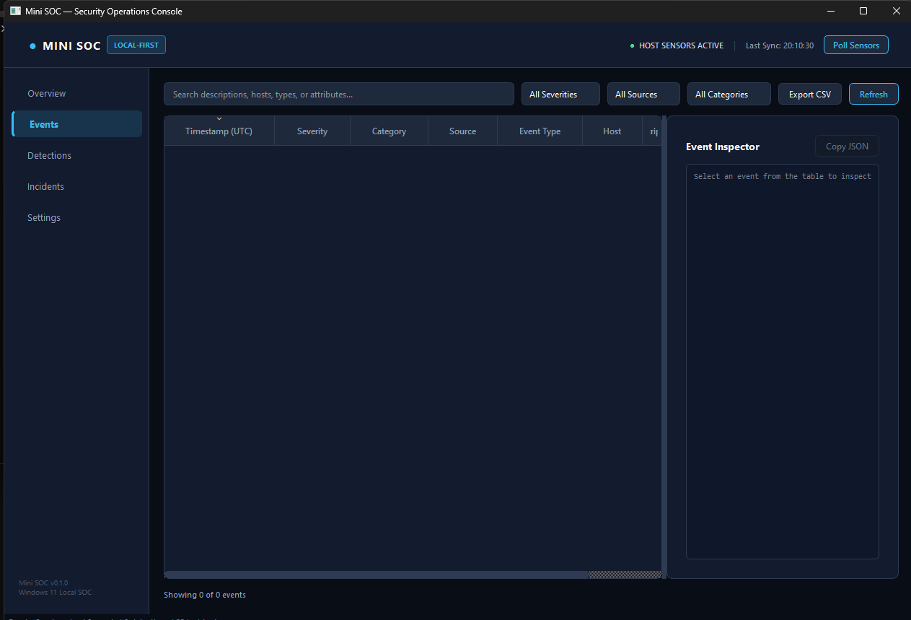
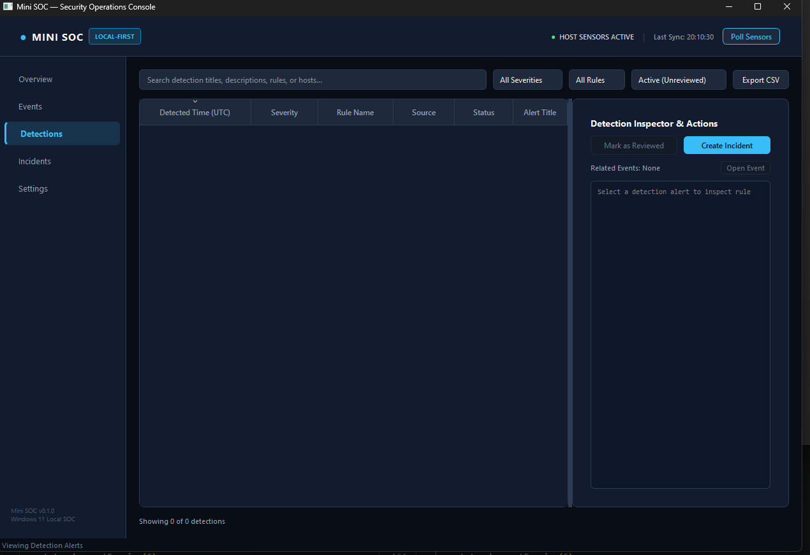
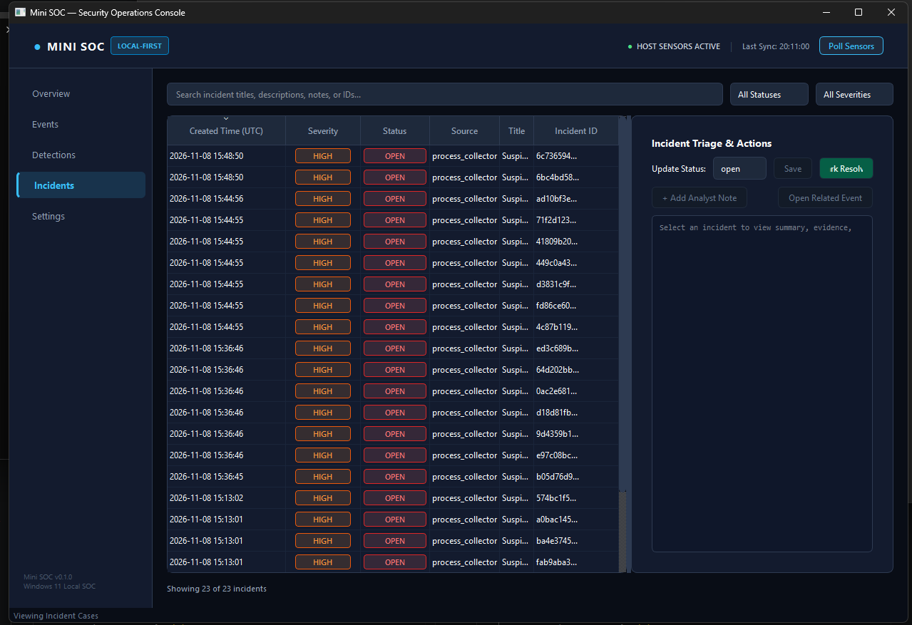

# Mini SOC

A standalone, local-first Security Operations Center (SOC) application tailored for Windows environments. Mini SOC provides lightweight, local host and network telemetry aggregation, suspicious activity detection, incident alerting, and guided investigation workflows — all running entirely on the local machine without external cloud dependencies.

---

## 1. Project Overview

Mini SOC is designed to run locally on a Windows workstation or server. It focuses on:
- **Local-first Operation**: All data, events, and telemetry stay on the local system.
- **Privacy & Security**: Zero telemetry phone-home, no credentials stored in configuration, and strict permission boundaries.
- **Standardized Telemetry**: A unified, validated security event schema across heterogeneous data collectors (host event logs, process execution, network connections).
- **Incident Lifecycle**: From raw event collection to rule-based detection, incident triage, and controlled response actions.
- **Analyst Console**: A PySide6 desktop dashboard for reviewing events, triaging detections, managing incidents, and exporting reports.

---

## 2. Architecture

The project follows a modular, decoupled architecture:

```
+─────────────────────────────────────────────────────────────+
│                          Mini SOC                           │
+─────────────────────────────────────────────────────────────+
│ [PySide6 Desktop Console]                                   │
│  Overview · Events · Detections · Incidents · Settings      │
+──────────────────────────┬──────────────────────────────────+
│ [Detection Engine]       │ [Incident Management]            │
│  Rule evaluation, alerts │  Triage, status lifecycle, notes │
+──────────────────────────┼──────────────────────────────────+
│ [Collectors]                                                │
│  Process Monitor · Network Monitor · Windows Event Logs     │
+─────────────────────────────────────────────────────────────+
│ [Core Foundation]                                           │
│  SecurityEvent (Pydantic v2) · AppConfig · SQLite Persist.  │
+─────────────────────────────────────────────────────────────+
```

### Core Components
- **`AppConfig`** (`src/core/config.py`): Centralized configuration. Resolves all paths relative to the project root, safely ensures data/log directories exist, stores no secrets.
- **`SecurityEvent`** (`src/core/events.py`): Pydantic v2 model with UUIDv4, UTC timestamps, severity enums, extensible attributes, bidirectional JSON & SQLite serialization.
- **`DatabaseManager`** (`src/database/connection.py`): SQLite connection management with foreign keys, timeouts, parameterized queries, and transaction support.
- **`EventRepository`** (`src/database/event_repository.py`): CRUD and filtered querying for security events.
- **`DetectionEngine`** (`src/detection/rules.py`): Heuristic evaluation for selected process command patterns, fully attributed failed-logon spikes, and established connections using selected remote service ports.
- **`IncidentManager`** (`src/incidents/manager.py`): Alert-to-incident conversion, status lifecycle, and analyst notes.

---

## Backend Concepts

This section explains the serverless/backend implementation in Mini SOC. "Backend" in this project means the local Python collection, normalization, persistence, detection, and incident-processing layers; it does not mean a web server or cloud service.

### End-to-End Data Flow

1. **Bootstrap** - `main.py` creates the application configuration, opens or initializes the SQLite database, and initializes the schema.
2. **Collection** - the Windows Event Log collector and host monitoring service read local telemetry.
3. **Normalization** - each source is converted into a Pydantic `SecurityEvent` with a consistent field contract.
4. **Persistence** - repositories serialize events and incidents to SQLite using parameterized queries and transactions.
5. **Detection** - `DetectionEngine` evaluates a snapshot of stored events with independent rule classes and stable alert identities.
6. **Incident management** - detections link idempotently to persistent incidents; analyst review state, notes, and lifecycle changes persist.
7. **Presentation** - the PySide6 window reads the repositories and cached backend state to update dashboard views and exports.

```text
Windows Event Log / psutil
            |
            v
Collector -> SecurityEvent -> EventRepository -> SQLite
                                  |
                                  v
                          DetectionEngine
                                  |
                                  v
                         DetectionAlert
                                  |
                                  v
                         IncidentManager -> IncidentRepository
```

### Application Entry Points

- `main.py` is the primary entry point.
  - Running it without arguments executes one headless collection/detection cycle.
  - Running it with `--gui` starts the PySide6 desktop application.
- `src/ui/app.py::run_app()` initializes configuration and SQLite, creates `MainWindow`, and starts the Qt event loop.
- `src/ui/main_window.py::MainWindow` owns the desktop application's backend wiring. It creates repositories, the host monitor, the Windows Event Log collector, the detection engine, and the incident manager.
- In GUI mode, process, network, and Windows Event Log collectors run continuously at the configured 5-second host polling interval. The background collector stops when the window closes. Manual **Poll Sensors** requests an immediate additional cycle, and the Qt UI refreshes database-backed views every 30 seconds.

### Configuration and Paths

`AppConfig` in `src/core/config.py` centralizes runtime paths and metadata:

| Setting | Default | Purpose |
|---|---|---|
| `app_name` | `Mini SOC` | Application display name |
| `version` | `0.1.0` | Application version |
| `project_root` | Directory containing the repository | Base directory for relative path overrides |
| `data_dir` | `%LOCALAPPDATA%\Mini SOC` on Windows (per-user OS data directory elsewhere) | Local application storage |
| `database_path` | `<data_dir>\minisoc.db` | SQLite database |
| `log_dir` | `<data_dir>\logs` | Operational log files |
| `retention_days` | `90` | Age of events removed at startup |

Set the absolute `MINISOC_DATA_DIR` environment variable to place the data and logs elsewhere, or pass an absolute `data_dir` to `AppConfig`. Relative path overrides are resolved against `project_root` and reject traversal. The data location is intentionally outside the checkout by default, so repositories under OneDrive are not the default storage location. `ensure_directories()` creates required directories. App configuration does not contain credentials or remote endpoints.

On first startup after upgrading, if the new database does not exist and the historical `<project_root>\data\minisoc.db` does, Mini SOC makes a consistent SQLite backup into the configured location. The old database is preserved; verify the new database and its event/incident counts before manually archiving or deleting the old copy. Migration does not move old logs or exports.

### Security Event Contract

`SecurityEvent` in `src/core/events.py` is the canonical backend event model.

| Field | Type | Meaning |
|---|---|---|
| `event_id` | UUID | Unique event identity; generated with UUIDv4 |
| `timestamp` | timezone-aware `datetime` | UTC event time |
| `source` | string | Collector or source, for example `process_collector` or `windows_event_log` |
| `category` | `EventCategory` or string | Domain such as PROCESS, NETWORK, AUTHENTICATION, or SYSTEM |
| `event_type` | string | Stable action name such as `process_started` or `windows_logon_failed` |
| `severity` | `EventSeverity` | `INFO`, `LOW`, `MEDIUM`, `HIGH`, or `CRITICAL` |
| `host` | string | Hostname or Windows computer name |
| `description` | string | Human-readable event summary |
| `attributes` | dictionary | Source-specific metadata, fields, IDs, paths, IPs, accounts, and ports |
| `schema_version` | string | Event contract version; currently `1.0` |

Pydantic validates event fields when a `SecurityEvent` is created or loaded. Empty source, host, event type, description, and schema strings are rejected. Category and severity values are normalized to uppercase. Naive timestamps are rejected and timezone-aware timestamps are converted to UTC. UUID, enum, datetime, and nested attribute values are converted to SQLite/JSON primitives by `to_db_record()` and reconstructed by `from_db_record()`.

### Collector Concepts

#### Process Collector

`ProcessCollector` uses `psutil.process_iter()` to snapshot running Windows processes. It records PID, executable name, creation time, executable path, username, and command line where accessible. Common command-line credential switches (such as `--password`, `--token`, and `--api-key`) have their values masked before persistence. This is best effort; arbitrary command text can still contain secrets.

The process key is `(PID, create_time)`. This combination avoids treating normal PID reuse as the same process instance. The collector maintains an in-memory set of known process keys:

- the GUI and headless entry points initialize a baseline before their first collection, so processes already running at startup are not reported as newly started;
- an instance not in the known set produces a `process_started` event;
- the known set is replaced with the current snapshot after each cycle.

Protected or disappeared processes are skipped without crashing the collection cycle. Restricted fields are left empty, and collector health counts each process with one or more access-denied fields once rather than counting every denied field read. When the snapshot succeeds but some fields are inaccessible, health reports limited visibility rather than a collector failure. The GUI requests UAC elevation at startup for better process visibility; if approval is declined or unavailable, it continues as a standard user and reports limited visibility. Even an elevated process may not access protected Windows processes.

#### Network Collector

`NetworkCollector` uses `psutil.net_connections(kind="inet")` to snapshot Internet-family sockets. It normalizes IPv4/IPv6 and TCP/UDP protocol names and records local/remote endpoints, status, and associated PID.

A connection key includes protocol, local address and port, remote address and port, and PID. The first unseen key emits `network_connection_observed`. Baseline initialization and subsequent polling prevent the same connection key from being reported repeatedly within a single in-memory monitoring session. A failed socket enumeration does not clear the previous baseline.

Listening sockets and other malformed or inaccessible entries are handled defensively; access-denied socket enumeration produces no events for that cycle rather than stopping the application, and the failure appears in collector health.

#### Windows Event Log Collector

`WindowsEventCollector` uses pywin32 native EvtQuery/EvtNext/EvtRender APIs. The default channels and event IDs are:

| Channel | IDs | Normalized result |
|---|---:|---|
| Security | 4624 | Successful Windows logon |
| Security | 4625 | Failed Windows logon |
| Security | 1102 | Security audit log cleared |
| System | 7045 | Windows service installed |

Raw event XML is parsed for the system header and named `EventData` values, then normalized into the common `SecurityEvent` model. On a channel with no checkpoint, the collector backfills matching records from the most recent seven days, oldest first, in batches of up to 100 until the query is exhausted. Each batch's events and highest successfully persisted record ID are committed atomically. If reading, rendering, normalization, or persistence fails, the checkpoint remains at the last committed record so the next poll can retry. Later polls query forward from the checkpoint. A cleared/rolled-over channel resets the checkpoint and starts the same seven-day backfill again.

A channel checkpoint is the highest successfully processed Windows `EventRecordID`, not a wall-clock timestamp. The collector detects channel reset/rollover by comparing the newest record ID with the stored checkpoint. Missing channels and denied access are reported once per channel and collection continues with other sources.

#### Host Monitoring Orchestration

`HostMonitorService` coordinates process, network, and (when configured) Windows Event Log collection. It supports one collection cycle or a daemon polling loop at a configurable interval (5 seconds by default). Each collector is invoked independently, so an exception in one does not prevent the others from running. GUI startup begins the loop; closing the window signals it to stop and waits up to a configurable timeout. Collection cycles are serialized so a manual poll cannot race the background collector.

### SQLite Persistence

`DatabaseManager` opens a short-lived SQLite connection for every repository operation. Connections enable foreign-key enforcement, use `sqlite3.Row`, have a 10-second busy timeout, commit successful operations, roll back exceptions, and close reliably.

The database is located at `data/minisoc.db` by default. It is a file-backed local database; tests can use `:memory:` databases.

#### Schema and Migrations

The schema is versioned in the `schema_version` table. `initialize_database()` safely applies missing migrations without overwriting existing records.

| Version | Tables/Indexes added | Purpose |
|---:|---|---|
| 1 | `security_events`, event indexes, `schema_version` | Core normalized telemetry |
| 2 | `event_log_checkpoints` | Per-channel Windows Event Log positions |
| 3 | `incidents`, incident indexes | Persisted analyst cases |
| 4 | incident alert fingerprints, `detection_alert_states` | Idempotent incident creation and persistent review state |

`security_events` stores every normalized event as primitive values. JSON in the `attributes` column preserves source-specific fields. Its indexes support timestamp, severity, source, and event-type queries.

`event_log_checkpoints` maps channel names to `last_record_id` and update time. It prevents replay of already processed Windows events across application restarts.

`incidents` stores title, description, severity, status, source, related event IDs, attributes, notes, creation time, and an optional unique detection fingerprint. Re-evaluating the same alert does not create another incident. `detection_alert_states` persists reviewed/unreviewed state by stable fingerprint.

#### Repositories

Repositories are the boundary between domain objects and SQLite:

- `EventRepository` inserts individual/batched events, atomically inserts events with checkpoints, retrieves by UUID, counts records, and lists filtered events newest-first.
- `CheckpointRepository` gets, updates, lists, and resets per-channel record IDs.
- `IncidentRepository` persists incidents and analyst state, retrieves by ID or alert fingerprint, lists incidents by status, and applies incident batches transactionally.

The repository API uses named or positional parameters instead of interpolating user input into SQL. Event and incident JSON fields are converted explicitly before database storage.

### Atomic Event/Checkpoint Transactions

Windows Event Log ingestion is checkpointed atomically. `save_events_with_checkpoint()` inserts all normalized events and updates the channel checkpoint in the same SQLite transaction. If event insertion or checkpoint update fails, the transaction is rolled back.

The collector also maintains an in-session record-key set and checks the persisted checkpoint, providing duplicate protection even if the same record arrives during repeated reads. The persisted checkpoint advances only to the highest successfully normalized and inserted record.

### Detection Engine

`DetectionEngine` combines a sequence of independent `DetectionRule` implementations and flattens their `DetectionAlert` results. The default engine contains three rules:

#### Suspicious Process Rule

**Scope:** examines `process_started` events and flags selected command-line patterns for `cmd.exe`, PowerShell, and administrative/dual-use tools including `rundll32.exe`, `regsvr32.exe`, `wmic.exe`, `mshta.exe`, `certutil.exe`, `bitsadmin.exe`, `netsh.exe`, `bcdedit.exe`, and `psexec.exe`.

For administrative binaries other than `cmd.exe` and PowerShell, an alert requires a configured command-line indicator rather than the process name alone. The alert severity is `HIGH`, and the event UUID is attached through `related_event_ids`. **Limitations and false positives:** these are dual-use tools; legitimate administration, software installation, and support activity can match. A match is a triage lead, not evidence of malicious intent. Validate user, parent process, full command line, and host context. Positive and benign command-line cases are covered by `tests/test_detection.py`.

#### Failed Logon Spike Rule

**Scope:** scans `windows_logon_failed` events from the preceding 10 minutes and raises a `HIGH` alert at three failures grouped by host, account, and a valid source IP. The alert links every supporting event. Missing/blank/placeholder host or account values and missing, placeholder, or invalid source IPs are excluded from correlation; they are not pooled under a shared `unknown` key. The Windows Event Log normalizer labels incomplete failed-logon attribution as `attribution_status: incomplete`; these events remain available for individual review. Account and IP representations are normalized for correlation. Separate episodes receive stable fingerprints so a repeated scan does not create another case while a later episode can be distinguished.

The rule's 10-minute window is independent of the Overview timeframe and event page. **Limitations and false positives:** repeated failures may come from user error, stale credentials, or an automated client; a threshold crossing does not prove brute force or compromise. Requiring attribution reduces cross-source aggregation but can miss activity when Windows does not provide account/source fields. Positive, sub-threshold, separated-host, and missing-attribution cases are covered by `tests/test_detection.py`.

#### Risky Service-Port Connection Rule

**Scope:** examines `network_connection_observed` events with a remote IP and remote port. It flags established connections whose remote endpoint is globally routable and uses selected service ports such as 22, 23, 3389, 445, 4444-4446, 8080, and 8443. Non-global IPv4/IPv6 addresses, non-established sockets, and other ports are excluded.

**Limitations and false positives:** this telemetry does not establish traffic direction or which endpoint initiated the connection. Common service ports are used by legitimate services, so a port match alone is not evidence of maliciousness. Validate the owning process, destination, and expected host behavior. Positive established/global/risky-port and benign port, private-address, listening, and non-established cases are covered by `tests/test_detection.py`.

Alerts are not a verdict: they identify patterns requiring analyst validation. The GUI creates at most one incident for each stable alert fingerprint; the incident retains supporting event IDs.

### Incident Model and Lifecycle

An `Incident` is a triage case created from one or more detection alerts. It contains a UUID, title, description, severity, status, source, related event IDs, attributes, analyst notes, and UTC creation time.

The supported workflow is:

```text
open -> investigating -> mitigated -> resolved
```

`IncidentManager`:

- converts `DetectionAlert` objects into `Incident` objects;
- stores new incidents through `IncidentRepository`;
- hydrates incidents from SQLite;
- updates status in memory and SQLite;
- appends analyst notes and persists the complete incident.

The manager does not own an automated containment or remediation system. Incident status and notes represent analyst workflow only.

### Reporting and Export

`ReportingExporter` creates common artifacts for analyst use:

- event CSV (core event fields);
- incident CSV (core incident fields);
- event JSON (including `attributes`);
- incident JSON (including attributes and notes);
- summary JSON (event severity, incident severity, incident status, and generated time).

Parent directories are created automatically for export destinations.

Exports are plaintext copies of security data. They are written to the path selected in the export dialog, are not encrypted by Mini SOC, and are not covered by the 90-day database event cleanup. Store them outside synchronized/shared folders, restrict access with OS ACLs, and apply your own retention and secure-deletion policy.

Create a consistent backup of the configured database while Mini SOC is running, using the SQLite online backup API:

```powershell
python -m src.database.backup "$env:USERPROFILE\Documents\MiniSOC-backup-2026-11-22.db"
```

The destination must not already exist. Keep backups in a protected, non-synchronized location, verify that the command completed, and periodically test opening a copy. Database backups include the records present at backup time; event retention deletes events older than 90 days when the application starts, not when a backup is created. Incidents and export files are not automatically expired.

### Security and Logging

The backend has multiple defensive measures:

- no network API server, cloud telemetry, secrets store, or remote credential configuration;
- database and logs default to a per-user OS data directory rather than the repository;
- database and logs are plaintext; Windows account permissions/ACLs are the access boundary, not application encryption;
- SQLite uses parameterized statements;
- timestamps are normalized and event fields are validated;
- local log entries are sanitized with `redact_sensitive_data()`;
- sensitive key names containing password, secret, token, API key, authorization, cookie, session, JWT, private key, or access key are replaced with `[REDACTED]`;
- collector exceptions are isolated so a process, network, or Windows channel failure does not crash the application.
- process command lines can contain secrets; the collector masks common credential switches, but that is best-effort and cannot identify arbitrary sensitive text.

Operational logs are written to `data/logs/minisoc.log`. The backend uses an INFO-level project logger by default, with file-only logging in the normal application process.

### GUI-to-Backend Synchronization

`MainWindow.refresh_all_data()` is the main GUI synchronization method:

1. optionally polls process, network, and Windows Event Log collectors;
2. loads one 100-event database page for the selected 1-hour, 24-hour, 7-day, or all-time timeframe;
3. independently queries matching evidence by detection event type, in bounded 500-event batches for per-event rules, using the selected timeframe unless a rule defines its own lookback; correlation rules receive the complete required window, so detection does not depend on the visible event page;
4. idempotently creates/reuses incidents and loads one 100-incident database page;
5. refreshes overview metrics, event/detection grids, incident panels, and settings diagnostics;
6. updates the last-synchronization timestamp.

The Events and Incidents views provide Previous/Next paging backed by SQLite offsets; their tables show 100 rows per page and report the current page and total count. Text/severity/source/category filters apply to the currently loaded page. The UI caches only that page for presentation; detection queries its own rule-specific evidence from SQLite rather than using the visible page.

The default 24-hour timeframe can hide older events while their incidents remain visible. Empty-state messages distinguish no stored telemetry, events outside the selected timeframe, and active search/filter results. Choose **All Time** to investigate older records. Opening an incident's supporting event automatically switches to **All Time** and loads that event directly, even when it is outside the most recent event page.

Process and network collectors intentionally baseline existing processes and connections at startup instead of generating a burst of startup events; they report only activity observed after that baseline. This reduces noise but means the initial state is not historical evidence. Poll intervals can miss processes or connections that start and end between polls, and Windows permissions can hide protected processes, connection details, or owning PIDs. Events with no matching records mean **not observed**, not proof that no activity occurred. The Overview reports no telemetry separately, while Settings shows each collector's last successful collection time, latest permission/error condition, and known visibility limitations. A healthy poll indicates that the collector ran without a reported error; it does not certify complete host coverage.

Telemetry older than 90 days is removed at application startup by default. Incidents retain their evidence IDs; if an event has aged out, the incident timeline marks it as no longer retained. The retention window can be changed through `AppConfig(retention_days=...)`. Exported files are outside this cleanup policy.

Mini SOC is a single-user local Windows desktop application; it has no built-in authentication or role management, and its database and logs are not encrypted. On the target Windows account, inspect the configured directory's ACLs (for the default location, `icacls "$env:LOCALAPPDATA\Mini SOC"`), confirm access is limited to the intended user and required Windows service/admin principals, and do not put storage on shared/network or synchronized locations. Do not remove inherited ACL entries without understanding their effect. Retention cleanup applies to database events at startup; exported files require separate secure handling and deletion.

### Backend Extension Guide

To add a new telemetry source:

1. create a collector that produces `SecurityEvent` instances;
2. add source/category-specific fields to `attributes`;
3. persist batches through `EventRepository`;
4. wire the collector into `HostMonitorService` or `MainWindow`;
5. add tests for collection, normalization, persistence, and failure handling.

To add a detection rule:

1. subclass `DetectionRule`;
2. set `name`, `description`, and `severity`;
3. implement `evaluate(events)` and return `DetectionAlert` objects;
4. link relevant event UUIDs through `related_event_ids`;
5. pass the rule into `DetectionEngine` or add it to the default rule list;
6. add positive and false-positive test cases.

SQLite schema changes should create a new migration version in `schema.py` and a corresponding table/repository test. Existing event and incident fields should not be renamed in place without migration and deserialization compatibility.

---

## 3. Project Directory Structure

```
mini-soc/
├── main.py                         # Entry point: headless (default) or --gui
├── requirements.txt                # Production and testing dependencies
├── README.md
├── data/                           # Local storage (SQLite database, logs)
│   └── .gitkeep
├── src/
│   ├── __init__.py
│   ├── core/
│   │   ├── config.py               # AppConfig
│   │   ├── events.py               # SecurityEvent model and enums
│   │   ├── logging_utils.py        # Operational and sanitized logging
│   │   └── security.py             # Redaction and safe path validation
│   ├── collectors/
│   │   ├── health.py                # Collector status, timestamps, and errors
│   │   ├── process_collector.py     # Windows process monitor (psutil)
│   │   ├── network_collector.py     # Network connection monitor (psutil)
│   │   ├── windows_event_collector.py  # Windows Event Log reader (pywin32)
│   │   └── monitor_service.py       # Orchestrator: HostMonitorService
│   ├── database/
│   │   ├── connection.py            # DatabaseManager
│   │   ├── schema.py               # Versioned schema migrations
│   │   ├── event_repository.py     # Event persistence
│   │   ├── alert_state_repository.py # Persisted detection review state
│   │   ├── checkpoint_repository.py # Event log checkpoint tracking
│   │   └── incident_repository.py  # Incident persistence
│   ├── detection/
│   │   └── rules.py                # DetectionEngine + built-in rules
│   ├── incidents/
│   │   ├── models.py               # Incident dataclass
│   │   └── manager.py              # IncidentManager
│   ├── reporting/
│   │   └── exporter.py             # CSV, JSON, and summary exporters
│   └── ui/
│       ├── app.py                  # run_app() PySide6 entry point
│       ├── main_window.py          # MainWindow shell with sidebar + header
│       ├── styles.py               # Dark cybersecurity theme and palette
│       ├── components/
│       │   ├── severity_badge.py   # SeverityBadge & StatusBadge widgets
│       │   └── status_card.py      # Metric summary card
│       └── views/
│           ├── overview_view.py    # Dashboard overview with status cards
│           ├── events_view.py      # Telemetry browser with filters & inspector
│           ├── detections_view.py  # Detection alerts with triage actions
│           ├── incidents_view.py   # Incident management panel
│           └── settings_view.py    # Diagnostics and configuration view
└── tests/
    ├── test_config.py
    ├── test_events.py
    ├── test_database.py
    ├── test_process_collector.py
    ├── test_network_collector.py
    ├── test_windows_event_collector.py
    ├── test_detection.py
    ├── test_reporting.py
    ├── test_security.py
    └── test_ui.py                  # PySide6 UI tests (offscreen)
```

---

## 4. Getting Started

### Prerequisites
- **Windows 10/11**
- **Python 3.12 or newer** (tested on Windows 11 with Python 3.14)
- **Git** to clone the repository

### Quick setup (Windows PowerShell)
```powershell
git clone https://github.com/I71gs/mini_soc.git
cd mini_soc
python -m venv .venv
.venv\Scripts\python.exe -m pip install --upgrade pip
.venv\Scripts\python.exe -m pip install -r requirements.txt
```

You do not need to activate the virtual environment when using the commands below; they call its Python executable directly. If you prefer to activate it in PowerShell, run:

```powershell
.\.venv\Scripts\Activate.ps1
```

If PowerShell blocks activation, continue using `.venv\Scripts\python.exe` as shown above.

### Try the desktop app

```powershell
.venv\Scripts\python.exe main.py --gui
```

When started from a UAC-filtered administrator account, the GUI requests administrator approval through the normal Windows UAC prompt each time. Approving elevates only that running SOC process; it does not add the account to another group or install a service. If you decline, the app continues with standard-user visibility. A standard account is not prompted for alternate administrator credentials and continues without elevation. The headless `python main.py` mode remains a one-shot, non-elevated collection run.

### Run the headless collection check

```powershell
.venv\Scripts\python.exe main.py
```

The first run initializes a local SQLite database under `%LOCALAPPDATA%\Mini SOC` on Windows and creates logs under its `logs` subdirectory (or uses the absolute `MINISOC_DATA_DIR` override). The app does not send telemetry to a cloud service. The headless run collects available host telemetry and attempts to read configured Windows Event Log channels.

> **Windows permissions:** Security Event Log access is controlled by the channel ACL and the user's effective Windows token. Where the channel ACL allows it, membership in the built-in **Event Log Readers** group can provide read access without running the SOC elevated. After changing group membership, sign out of Windows and sign back in so the new logon token includes the group. The app reports denied access and continues collecting other available telemetry; do not broaden the channel ACL or run elevated permanently just to make the status green.

Process and network telemetry also depends on the Windows account's visibility into other processes and connections. Restricted or protected processes may be omitted, and process ownership may be unavailable. The Settings view reports each collector's latest health and error; the headless run prints the same status. Do not treat a healthy collector as proof that the OS exposed every possible record.

### Troubleshooting and clean-install acceptance

- **Events or detections are empty:** inspect the selected time range, clear view filters, and check the stored-event count. Older incidents can remain visible after their events fall outside the default 24-hour window. Use **All Time** or open the incident's evidence link.
- **No Windows authentication events:** check the Windows Event Log collector status and its displayed error. Verify the Security channel ACL and the account's effective token. If authorized and allowed by that ACL, use Event Log Readers membership, then sign out and back in before retesting. Avoid broad ACL changes or permanent elevation.
- **Host telemetry is missing:** inspect Process Collector and Network Collector status in Settings. Access-denied and per-process visibility limits are reported; unavailable process metadata is not evidence that no activity occurred.
- **Clean install:** use a fresh checkout and virtual environment, install `requirements.txt`, run `python main.py` once, then launch `python main.py --gui`. Confirm the database and log directories under `%LOCALAPPDATA%\Mini SOC` are created, inspect the folder ACL with `icacls`, and confirm collector status and empty states are clear. Repeat as a standard user and, only where authorized, with the intended minimum Windows Event Log permissions.
- **Upgrade or retention:** use `python -m src.database.backup <new-backup-path>` before upgrades or data cleanup. The default 90-day event cleanup runs at startup; incidents remain, but evidence older than retention will no longer resolve. Exports are not automatically expired.

#### Dependencies
| Package | Purpose |
|---|---|
| `pydantic>=2.0.0` | Data validation and serialization for event contracts |
| `psutil>=5.9.0` | Process and network telemetry collection |
| `pywin32>=306` | Windows Event Log API access |
| `PySide6>=6.5.0` | Desktop GUI framework |
| `pytest>=7.0.0` | Automated test runner |

---

## 5. Running the Application

The quick-start commands above use the project virtual environment. If you activated it, you can use `python` instead of `.venv\Scripts\python.exe`.

### Headless Mode
Collect available telemetry, run detection rules, and print a summary to the console:

```powershell
.venv\Scripts\python.exe main.py
```

### Desktop GUI Mode
Launch the PySide6 security console:

```powershell
.venv\Scripts\python.exe main.py --gui
```

Or launch the UI module directly:

```powershell
.venv\Scripts\python.exe -m src.ui.app
```

### Desktop Console Features
- **Overview**: Status cards (events, detections, incidents, health), host summary, timeframe filters (1h / 24h / 7d / All), recent activity and detections tables.
- **Events**: Full telemetry browser with severity, source, category, and text filters. Sortable columns, JSON inspector, copy-to-clipboard, CSV export.
- **Detections**: Rule-based alerts with mark-as-reviewed, create-incident, open-related-event, severity/rule/status filters, CSV export.
- **Incidents**: Lifecycle management (open → investigating → mitigated → resolved), analyst notes, related event navigation.
- **Settings**: Environment paths, database health, schema version, record counts, checkpoint metadata, sensor status.

### Screenshots

| Overview | Events |
|---|---|
|  |  |

| Detections | Incidents |
|---|---|
|  |  |

---

## 6. Running Tests

```powershell
.venv\Scripts\python.exe -m pytest -v
```

Run a specific test file:

```powershell
.venv\Scripts\python.exe -m pytest -v tests/test_ui.py        # PySide6 desktop UI tests
.venv\Scripts\python.exe -m pytest -v tests/test_database.py  # SQLite persistence tests
.venv\Scripts\python.exe -m pytest -v tests/test_detection.py # Detection engine tests
```

The tests use mocks and temporary databases for most collector and persistence checks; they do not require access to a real Security Event Log. The UI tests run without needing to open the desktop window.

The suite covers configuration, events, database, collectors, detection, reporting, security, and UI. The test count can change as tests are added.

---

## 7. Implementation Status

| Feature / Component | Status | Details |
|---|---|---|
| Project Structure | ✅ Complete | Modular package skeleton: core, collectors, database, detection, incidents, ui |
| Central Configuration | ✅ Complete | Deterministic path resolution, data/log directory creation, zero secrets |
| Security Event Model | ✅ Complete | Pydantic v2 `SecurityEvent` with UUIDv4, UTC enforcement, extensible attributes |
| SQLite Persistence | ✅ Complete | Versioned schema, indexes, checkpoints, EventRepository, IncidentRepository |
| Host Telemetry Collectors | ✅ Complete | Process and network connection collectors with deduplication and visible health |
| Windows Event Log Collector | ✅ Complete | Security & System logs (IDs 4624, 4625, 1102, 7045), persistent checkpoints and permission errors |
| Monitoring Orchestrator | ✅ Complete | HostMonitorService for polling with error isolation |
| Detection Engine | ✅ Complete | 3 heuristic rules: selected suspicious process command patterns, fully attributed failed-logon spikes, and established connections using selected remote service ports |
| Incident Workflow | ✅ Complete | Stable alert deduplication, status lifecycle, analyst notes, evidence timeline, SQLite persistence |
| Reporting & Export | ✅ Complete | CSV and JSON export for events, incidents, and summaries |
| Desktop Console (PySide6) | ✅ Complete | 5-view dashboard with dark theme, severity badges, filters, triage actions, CSV export |
| Automated Test Suite | ✅ Complete | Tests cover all subsystems including UI tests |
