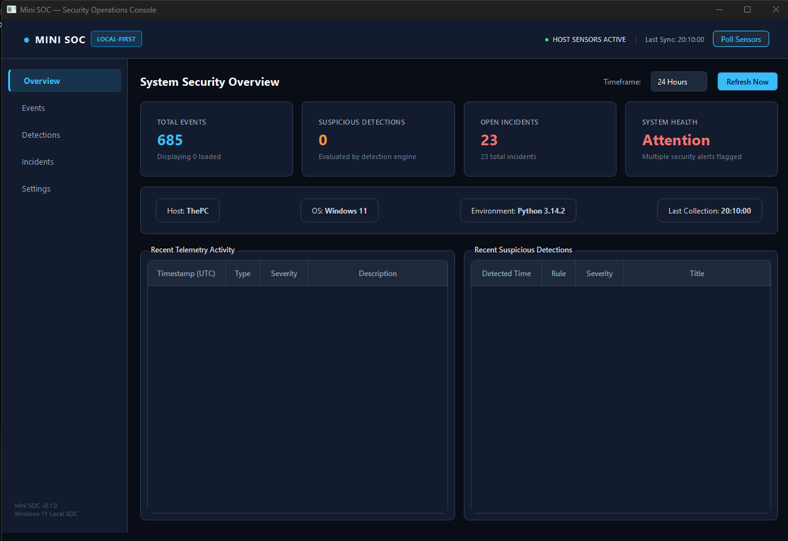

# Mini SOC

A standalone, local-first Security Operations Center (SOC) application tailored for Windows environments. Mini SOC provides lightweight, local host and network telemetry aggregation, suspicious activity detection, incident alerting, and guided investigation workflows — all running entirely on the local machine without external cloud dependencies.

---

## 1. Project Overview

Mini SOC is designed to run locally on a Windows workstation or server. It focuses on:
- **Local-first Operation**: All data, events, and telemetry stay on the local system.
- **Privacy & Security**: Zero telemetry phone-home, no credentials stored in configuration, and strict permission boundaries.
- **Standardized Telemetry**: A unified, validated security event schema across heterogeneous data collectors (host event logs, process execution, network connections).
- **Incident Lifecycle**: From raw event collection to rule-based detection, incident triage, and controlled response actions.
- **Analyst Console**: A PySide6 desktop dashboard for reviewing events, triaging detections, managing incidents, and exporting reports.

---

## 2. Architecture

The project follows a modular, decoupled architecture:

```
+─────────────────────────────────────────────────────────────+
│                          Mini SOC                           │
+─────────────────────────────────────────────────────────────+
│ [PySide6 Desktop Console]                                   │
│  Overview · Events · Detections · Incidents · Settings      │
+──────────────────────────┬──────────────────────────────────+
│ [Detection Engine]       │ [Incident Management]            │
│  Rule evaluation, alerts │  Triage, status lifecycle, notes │
+──────────────────────────┼──────────────────────────────────+
│ [Collectors]                                                │
│  Process Monitor · Network Monitor · Windows Event Logs     │
+─────────────────────────────────────────────────────────────+
│ [Core Foundation]                                           │
│  SecurityEvent (Pydantic v2) · AppConfig · SQLite Persist.  │
+─────────────────────────────────────────────────────────────+
```

### Core Components
- **`AppConfig`** (`src/core/config.py`): Centralized configuration. Resolves all paths relative to the project root, safely ensures data/log directories exist, stores no secrets.
- **`SecurityEvent`** (`src/core/events.py`): Pydantic v2 model with UUIDv4, UTC timestamps, severity enums, extensible attributes, bidirectional JSON & SQLite serialization.
- **`DatabaseManager`** (`src/database/connection.py`): SQLite connection management with foreign keys, timeouts, parameterized queries, and transaction support.
- **`EventRepository`** (`src/database/event_repository.py`): CRUD and filtered querying for security events.
- **`DetectionEngine`** (`src/detection/rules.py`): Rule-based evaluation for suspicious processes, failed logon spikes, and risky outbound connections.
- **`IncidentManager`** (`src/incidents/manager.py`): Alert-to-incident conversion, status lifecycle, and analyst notes.

---

## 3. Project Directory Structure

```
mini-soc/
├── main.py                         # Entry point: headless (default) or --gui
├── requirements.txt                # Production and testing dependencies
├── README.md
├── data/                           # Local storage (SQLite database, logs)
│   └── .gitkeep
├── src/
│   ├── __init__.py
│   ├── core/
│   │   ├── config.py               # AppConfig
│   │   └── events.py               # SecurityEvent model and enums
│   ├── collectors/
│   │   ├── process_collector.py     # Windows process monitor (psutil)
│   │   ├── network_collector.py     # Network connection monitor (psutil)
│   │   ├── windows_event_collector.py  # Windows Event Log reader (pywin32)
│   │   └── monitor_service.py       # Orchestrator: HostMonitorService
│   ├── database/
│   │   ├── connection.py            # DatabaseManager
│   │   ├── schema.py               # Versioned schema migrations
│   │   ├── event_repository.py     # Event persistence
│   │   ├── checkpoint_repository.py # Event log checkpoint tracking
│   │   └── incident_repository.py  # Incident persistence
│   ├── detection/
│   │   └── rules.py                # DetectionEngine + built-in rules
│   ├── incidents/
│   │   ├── models.py               # Incident dataclass
│   │   └── manager.py              # IncidentManager
│   └── ui/
│       ├── app.py                  # run_app() PySide6 entry point
│       ├── main_window.py          # MainWindow shell with sidebar + header
│       ├── styles.py               # Dark cybersecurity theme and palette
│       ├── components/
│       │   ├── severity_badge.py   # SeverityBadge & StatusBadge widgets
│       │   └── status_card.py      # Metric summary card
│       └── views/
│           ├── overview_view.py    # Dashboard overview with status cards
│           ├── events_view.py      # Telemetry browser with filters & inspector
│           ├── detections_view.py  # Detection alerts with triage actions
│           ├── incidents_view.py   # Incident management panel
│           └── settings_view.py    # Diagnostics and configuration view
└── tests/
    ├── test_config.py
    ├── test_events.py
    ├── test_database.py
    ├── test_process_collector.py
    ├── test_network_collector.py
    ├── test_windows_event_collector.py
    ├── test_detection.py
    ├── test_reporting.py
    ├── test_security.py
    └── test_ui.py                  # PySide6 UI tests (offscreen)
```

---

## 4. Getting Started

### Prerequisites
- **Windows 10/11**
- **Python 3.12 or newer** (tested on Windows 11 with Python 3.14)
- **Git** to clone the repository

### Quick setup (Windows PowerShell)
```powershell
git clone https://github.com/I71gs/mini_soc.git
cd mini_soc
python -m venv .venv
.venv\Scripts\python.exe -m pip install --upgrade pip
.venv\Scripts\python.exe -m pip install -r requirements.txt
```

You do not need to activate the virtual environment when using the commands below; they call its Python executable directly. If you prefer to activate it in PowerShell, run:

```powershell
.\.venv\Scripts\Activate.ps1
```

If PowerShell blocks activation, continue using `.venv\Scripts\python.exe` as shown above.

### Try the desktop app

```powershell
.venv\Scripts\python.exe main.py --gui
```

### Run the headless collection check

```powershell
.venv\Scripts\python.exe main.py
```

The first run initializes a local SQLite database at `data\minisoc.db` and creates local logs under `data\logs`. The app does not send telemetry to a cloud service. The headless run collects available host telemetry and attempts to read configured Windows Event Log channels.

> **Windows permissions:** Windows may deny access to the Security Event Log when the app is run as a standard user. The app should still start; Security log collection will be unavailable in that session. Run with the required Windows permissions only if you need to test that source, and only on a machine you are authorized to monitor.

#### Dependencies
| Package | Purpose |
|---|---|
| `pydantic>=2.0.0` | Data validation and serialization for event contracts |
| `psutil>=5.9.0` | Process and network telemetry collection |
| `pywin32>=306` | Windows Event Log API access |
| `PySide6>=6.5.0` | Desktop GUI framework |
| `pytest>=7.0.0` | Automated test runner |

---

## 5. Running the Application

The quick-start commands above use the project virtual environment. If you activated it, you can use `python` instead of `.venv\Scripts\python.exe`.

### Headless Mode
Collect available telemetry, run detection rules, and print a summary to the console:

```powershell
.venv\Scripts\python.exe main.py
```

### Desktop GUI Mode
Launch the PySide6 security console:

```powershell
.venv\Scripts\python.exe main.py --gui
```

Or launch the UI module directly:

```powershell
.venv\Scripts\python.exe -m src.ui.app
```

### Desktop Console Features
- **Overview**: Status cards (events, detections, incidents, health), host summary, timeframe filters (1h / 24h / 7d / All), recent activity and detections tables.
- **Events**: Full telemetry browser with severity, source, category, and text filters. Sortable columns, JSON inspector, copy-to-clipboard, CSV export.
- **Detections**: Rule-based alerts with mark-as-reviewed, create-incident, open-related-event, severity/rule/status filters, CSV export.
- **Incidents**: Lifecycle management (open → investigating → mitigated → resolved), analyst notes, related event navigation.
- **Settings**: Environment paths, database health, schema version, record counts, checkpoint metadata, sensor status.

### Screenshots

| Overview | Events |
|---|---|
|  |  |

| Detections | Incidents |
|---|---|
|  |  |

---

## 6. Running Tests

```powershell
.venv\Scripts\python.exe -m pytest -v
```

Run a specific test file:

```powershell
.venv\Scripts\python.exe -m pytest -v tests/test_ui.py        # PySide6 desktop UI tests
.venv\Scripts\python.exe -m pytest -v tests/test_database.py  # SQLite persistence tests
.venv\Scripts\python.exe -m pytest -v tests/test_detection.py # Detection engine tests
```

The tests use mocks and temporary databases for most collector and persistence checks; they do not require access to a real Security Event Log. The UI tests run without needing to open the desktop window.

The suite covers configuration, events, database, collectors, detection, reporting, security, and UI. The test count can change as tests are added.

---

## 7. Implementation Status

| Feature / Component | Status | Details |
|---|---|---|
| Project Structure | ✅ Complete | Modular package skeleton: core, collectors, database, detection, incidents, ui |
| Central Configuration | ✅ Complete | Deterministic path resolution, data/log directory creation, zero secrets |
| Security Event Model | ✅ Complete | Pydantic v2 `SecurityEvent` with UUIDv4, UTC enforcement, extensible attributes |
| SQLite Persistence | ✅ Complete | Versioned schema, indexes, checkpoints, EventRepository, IncidentRepository |
| Host Telemetry Collectors | ✅ Complete | Process and network connection collectors with deduplication |
| Windows Event Log Collector | ✅ Complete | Security & System logs (IDs 4624, 4625, 1102, 7045), persistent checkpoints |
| Monitoring Orchestrator | ✅ Complete | HostMonitorService for polling with error isolation |
| Detection Engine | ✅ Complete | 3 rules: suspicious processes, failed logon spikes, risky outbound ports |
| Incident Workflow | ✅ Complete | Alert → Incident conversion, status lifecycle, analyst notes, SQLite persistence |
| Reporting & Export | ✅ Complete | CSV and JSON export for events, incidents, and summaries |
| Desktop Console (PySide6) | ✅ Complete | 5-view dashboard with dark theme, severity badges, filters, triage actions, CSV export |
| Automated Test Suite | ✅ Complete | Tests cover all subsystems including UI tests |
